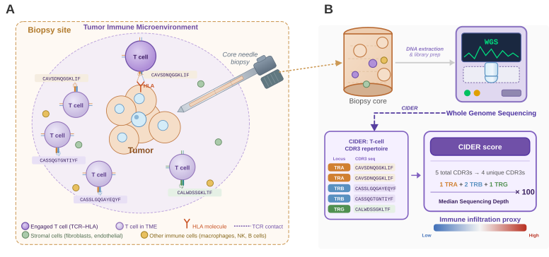

# CIDER Immune Infiltration Analysis

Analysing immune infiltration in immunotherapy-treated cancer patients using CIDER (CDR3 sequence-based immune reconstruction), with survival, response, and multi-omic correlation analyses across clinical cohorts derived from the Hartwig Medical Foundation dataset.



*Figure 1. CIDER Score pipeline. (A) The Hartwig WGS pipeline integrates CDR3 clonotype counts from CIDER with sequencing depth from COBALT and tumour purity from PURPLE to produce the CIDER Score — a normalised measure of T-cell immune infiltration. (B) CIDER quantifies unique CDR3 sequences arising from V(D)J recombination at three TCR loci (TRA/TRD, TRB, TRG), which are aggregated into the CIDER T-cell Score.*

---

## Repository structure

```
CIDER_immune_infiltration/
├── helpers/
│   ├── map.r         # Path constants, get_fp(), assert_files_exist(), safe_read()
│   ├── config.r      # Project-wide constants (score formula, cohort level orders, ICI
│   │                 #   treatment/mechanism lookup, table thresholds) — see below
│   ├── shortcuts.r   # Library loading + utilities (set_plot_dims, top, fct_pin_last(),
│   │                 #   build_cider_base(), …)
│   ├── themes.r      # ggplot theme, Okabe-Ito palette, figure_annotation(), density_alpha(),
│   │                 #   tag layers, response_plot()
│   └── table_notebooks.R  # TABLE_NOTEBOOKS: Table 1 / S1-S5 list, shared by
│                          #   run_figures.R and run_tables.R
│
├── 0_prepare/        # Data preparation — run in order
│   ├── 0_collect.ipynb               # Collect PURPLE, CIDER, COBALT files from data request
│   ├── 1_cider.ipynb                 # Parse CIDER VDJ output → cider_base.csv
│   ├── 1b_cider_by_confidence.ipynb  # PASS-only / low-confidence-only CIDER variants (robustness check)
│   ├── 2_rna.ipynb                   # T-cell + CD8 Effector (tGE8) + 6 independent RNA gene-set comparators → isofox_genesets_ready_log2.csv
│   ├── 3_meta.ipynb                  # Assemble clinical + DNA + RNA metadata → meta_base.csv
│   ├── 4_base.ipynb                  # Merge, compute CIDER Scores, assign cohorts → ready.rds / cpi_ready.rds
│   ├── 5_models.ipynb                # Fit Cox-PH and logistic models → models_ready.rds
│   ├── 6_extra_markers.ipynb         # Somatic driver features → extra_markers.rds
│   └── collect_ImmuneLENS/           # SLURM scripts for ImmuneLENS (RNA deconvolution reference
│                                     #   for 4_cider_validation.ipynb); not called by run_*.R
│
├── 1_figures/        # Figure generation — run after 0_prepare
│   ├── 0_landscape.ipynb                    # CIDER Score landscape (full Hartwig cohort)
│   ├── 1_response.ipynb                     # CIDER Score vs ICI response
│   ├── 2_survival.ipynb                     # Overall survival by CIDER High/Low
│   ├── 2b_survival_specificity.ipynb        # Panel A of supplement_survival_specificity.png: OS by CIDER High/Low, ICI specificity (treatment class)
│   ├── 3_survival_with_tmb.ipynb            # Overall survival by CIDER × TMB groups
│   ├── 3b_survival_tmb_specificity.ipynb    # Panel B of supplement_survival_specificity.png: OS by CIDER × TMB, ICI specificity (treatment class)
│   ├── 4_cider_validation.ipynb             # CIDER Score validation: RNA and ImmuneLENS
│   ├── 5_cider_vs_tmb.ipynb                 # CIDER Score vs TMB
│   ├── 6_cider_vs_purity.ipynb              # Purity/depth adjustment diagnostics
│   ├── 7_predicted_response_landscape.ipynb # Predicted response landscape (Figure 7 panels) — loads the combined model from 9_roc.ipynb, run that first
│   ├── 8_forest.ipynb                       # Forest plots (Cox-PH and logistic models)
│   ├── 9_roc.ipynb                          # ROC/AUC: CIDER vs TMB vs combined — also fits + saves the shared TMB+CIDER model used by 7_predicted_response_landscape.ipynb
│   ├── 10_unique_vs_total.ipynb             # Unique vs total CDR3 read comparison
│   ├── 11_demographic_table.ipynb           # Table 1 (main text): ICI cohort demographics by response
│   ├── 11b_demographic_table_full_cohort.ipynb  # Table S3: full pan-cancer cohort demographics
│   ├── 11c_pretreatment_by_subcohort.ipynb  # Table S2: pretreatment % by tumor type
│   ├── 11d_tumor_type_by_msi_status.ipynb   # Table S4: primary tumor type × MSI status
│   ├── 11e_treatment_by_mechanism_response.ipynb  # Table S5: ICI regimens by mechanism × response
│   ├── 11f_biopsy_location_breakdown.ipynb  # Table S1: biopsy location breakdown
│   ├── 12_combined_figures.ipynb            # Superseded by assemble_main_figures.R; unused, safe to delete
│   ├── 12_xgboost_model.ipynb               # XGBoost vs logistic regression (CIDER + TMB)
│   ├── 13_driver_tcell.ipynb                # Driver gene × T-cell: systematic regression analysis
│   ├── 14_depth_stability.ipynb             # CIDER score stability across sequencing depth
│   ├── 15_ici_specificity.ipynb             # ICI specificity of CIDER T-cell score (adjusted for tumor type, age, sex, biopsy location, purity)
│   ├── 16_diversity_metrics.ipynb           # Supplement: TCR diversity metrics vs ICI response
│   ├── 17_response_by_read_confidence.ipynb # Supplement: CIDER T-cell Score vs response, by CDR3 read-confidence filter and cohort
│   ├── 19_dna_vs_rna_response.ipynb         # Supplement: DNA-based CIDER T-cell Score vs RNA (T-cell signature + CD8 Effector + PDL1) — response discrimination by cohort
│   ├── 20_ici_specificity_main.ipynb        # Figure 6: predictive specificity of CIDER T-cell score for ICI therapy vs. general prognostic effects (BOR/OS, TMB-adjusted) — simplified main-figure companion to 15_ici_specificity.ipynb
│   └── 21_tcell_geneset_panel.ipynb         # Supplement: CIDER T-cell Score vs 5 independent RNA gene-set signatures (Infiltration/Effector/PDL1) -- (A) bar plot of Pearson r, (B) ICI responder-discrimination boxplot
│
├── run_collect.R     # Step 1: collect raw data from WGS data request
├── run_prepare.R     # Step 2: prepare analysis-ready datasets
├── run_figures.R     # Step 3: generate figures, then assemble + collect (scripts below)
├── run_tables.R      # Optional: regenerate only Table 1 / S1-S5, skipping the rest of step 3
├── run_all.R         # Run collect + prepare + figures (delegates to the scripts above)
├── run_analysis.sh   # Convenience wrapper: `Rscript run_all.R prepare figures` (skips collect)
│
├── assemble_main_figures.R            # Figures 2–6, from 1_figures/ panel .rds outputs
├── assemble_purity_figure.R           # supplement_purity.png
├── assemble_survival_specificity_figure.R  # supplement_survival_specificity.png (Panel A: CIDER-only, Panel B: CIDER x TMB)
├── assemble_nonresponse_figure.R      # figure_7.png
├── assemble_unique_vs_total_figure.R  # supplement_unique_vs_total.png
├── assemble_validation_figure.R       # supplement_correlation.png (kept for reference; not run by run_figures.R/run_all.R)
├── assemble_supplementary_tables_excel.R  # supplementary_tables.xlsx: Tables S1-S5 combined into one workbook
├── collect_paper_figures.R            # Copy final figures + tables → figs/paper/
│
├── fig_references/                    # Static reference assets checked into the repo (not pipeline output)
│   ├── figure_legends.docx            # Drafted figure legend text for all main/supplementary figures
│   └── schematic_figs/
│       ├── figure1.svg / figure1.png  # Figure 1 pipeline schematic (shown at the top of this README)
│       └── model_schematic.svg        # Response-prediction model schematic, used by
│                                       #   7_predicted_response_landscape.ipynb (Figure 7, panel A)
│
└── requirements.txt  # Python dependencies (nbstripout)
```

---

## CIDER Score

Two score variants are computed in `4_base.ipynb` and carried through all downstream analyses:

| Column | Formula | Use |
|---|---|---|
| `cider_score` | `cdr3_unique` | Raw count; reference |
| `cider_score_depth_adj` | `cdr3_unique / sampleMedianDepth` | Depth-normalised only; used for RNA and ImmuneLens validation |
| `cider_score_adj` | `cdr3_unique / (sampleMedianDepth × max(1 − purity, 0.10))` | Primary clinical metric; depth + purity corrected |

Scores are on a ratio scale (no log2 transformation). `log1p()` is applied before scaling in modelling notebooks. `PURITY_CAP = 0.10` assumes at least 10% non-tumour fraction.

High/Low patient groups for Kaplan–Meier analyses are defined by the pan-cancer median `cider_score_adj` across all ICI-treated patients.

---

## Cohort definitions

Cohort assignment happens in `3_meta.ipynb` via `assign_immunotherapy_cohorts()`, which maps each sample's primary tumour location and histology to one of five broad groups. Sample counts and display labels are added in `4_base.ipynb`.

| Column | Description |
|---|---|
| `cohort_broad` | Five fixed clinical groups: **SKCM · NSCLC · BLCA · CRC-MSI · Other** (+ a Pan-Cancer row added by duplication) |
| `cohort_broad_go` | Same labels with sample size, e.g. `"SKCM (N = 156)"` — used for plot axis labels |
| `cohort_pan` | 22-level pan-database scheme (BRCA, NSCLC, CRC-MSS, CUP, …) covering the full Hartwig cohort, not just ICI-treated patients; used for the Figure 2A landscape, Figure 7's predicted response landscape, and (as full tumor-type names — see below) Table S3's "Cohort" column. Includes a "Non-CRC MSI" category pooling MSI-high patients from any non-colorectal tissue — every other named cohort is therefore MSI-low/MSI-unknown only |

Fixed level orders live in `helpers/config.r`: `BROAD_LEVELS` (`Pan-Cancer → SKCM → NSCLC → BLCA → CRC-MSI → Other`) and `PAN_LEVELS` (22 cohorts by descending N, `"Other"` always last).

Figures use bare acronyms (axis space is tight, and TCGA-style acronyms are standard shorthand there). The supplemental tables (S2-S4) instead show **full tumor-type names**, e.g. "Breast cancer (BRCA)" — see `COHORT_FULL_NAMES` (`helpers/config.r`) and `full_cohort_name()` (`helpers/shortcuts.r`), which relabels a `cohort_broad`/`cohort_pan` value into that format, falling back to the input unchanged for non-acronym labels like "Other".

`config.r` also holds the other project-wide constants shared across notebooks: the CIDER Score formula's `PURITY_CAP`/`SCORE_SCALE`, `TMB_HIGH_THRESHOLD` for TMB High/Low stratification, the `ICI_TREATMENT_NORM`/`ICI_MECHANISM_MAP` lookup that canonicalizes raw treatment strings into regimen names and mechanism categories (Anti-PD1/Anti-PDL1/Anti-CTLA4/Combo), `BIOPSY_PRIMARY_TUMOR_RAW_VALUES` (raw strings identifying a primary-tumor biopsy, used only by Table S1), and `SUBCOHORT_MIN_OTHER_TYPE_N` — the minimum N a granular category needs for its own row nested under an "Other" subtotal, rather than being pooled into "Other (Other)"; shared by every supplementary table that nests an "Other" breakdown (S1, S2, S4). See the comments in the file for the full rationale behind each value.

---

## Figure outputs

All figures are saved to `CIDER_PROJ_DIR/figs/`. Main figures are bold.

### Main figures

| Figure file | Biological rationale | Description | Script |
|---|---|---|---|
| **`figure_2.png`** | Establishes that CIDER Score measures genuine immune infiltration, independent of technical confounders | Landscape across full Hartwig cohort · RNA correlation · purity correction validation | [`assemble_main_figures.R`](assemble_main_figures.R) |
| **`figure_3.png`** | Shows CIDER Score identifies patients most likely to respond to ICI therapy | CIDER Score vs ICI response across cancer types | [`assemble_main_figures.R`](assemble_main_figures.R) |
| **`figure_4.png`** | Shows CIDER Score stratifies patients by survival outcomes | Overall survival by CIDER High/Low across cancer types | [`assemble_main_figures.R`](assemble_main_figures.R) |
| **`figure_5.png`** | Shows CIDER and TMB capture orthogonal biology and that combining them improves patient stratification | (A) TMB independence scatter · (B) ROC curves — CIDER, TMB, and combined (`response ~ log2(CIDER+1) + log2(TMB+1)`), 10×10-fold CV AUC · (C) Pan-Cancer CIDER × TMB survival | [`assemble_main_figures.R`](assemble_main_figures.R) |
| **`figure_6.png`** | Shows the CIDER T-cell Score's association with outcome is specific to ICI therapy (predictive), not simply a general prognostic effect across treatments | Two-panel forest plot: Cohort-Specific Effect (within-group BOR/OS effect size for ICI Therapy, Non-ICI Therapy, Chemotherapy, Targeted therapy, Hormonal therapy) and Interaction / Relative Effect (`cider_log2 * is_ici` interaction tests, ICI vs. each comparator), each under two covariate specs (None / TMB+Clinical+Purity). Simplified to BOR and OS only and to the headline comparisons — the full endpoint/test set (DCB, PFS, MSS-restricted sensitivity checks) lives in `supplement_ici_specificity.png` | [`assemble_main_figures.R`](assemble_main_figures.R) |
| **`figure_7.png`** | Shows a CIDER + TMB model predicts ICI response and projects response likelihood onto untreated patients | Model schematic · predicted response in ICI cohorts · predicted response landscape (all Hartwig patients). Panel C's "Model AUC" is the same TMB+CIDER combined model/AUC as Figure 5B — loaded from `9_roc.ipynb`, not refit — so the two numbers always match | [`assemble_nonresponse_figure.R`](assemble_nonresponse_figure.R) |

### Supplementary figures

| Figure file | Biological rationale | Description | Script |
|---|---|---|---|
| `figure_s1.png` | Motivates the dual purity + depth correction in the CIDER Score formula | Raw CIDER Score correlation with purity and sequencing depth | [`6_cider_vs_purity.ipynb`](1_figures/6_cider_vs_purity.ipynb) |
| `figure_s2.png` | Shows the survival signal extends to progression-free survival, not just OS | PFS — T-cell CIDER High/Low | [`2_survival.ipynb`](1_figures/2_survival.ipynb) |
| `supplement_survival_specificity.png` | Shows both the CIDER High/Low overall-survival association, and Figure 5's CIDER × TMB joint prognostic value, are specific to ICI therapy, not a general prognostic effect | (A) CIDER High/Low Kaplan-Meier curves (HR, log-rank p) for ICI Therapy, Non-ICI Therapy, Chemotherapy, Targeted therapy, Hormonal therapy, and Multiple therapy (3×2 layout) — all classified by Figure 4's own ICI-treated High/Low cutoff · (B) Per-cohort overall-survival curves crossing CIDER High/Low (colour) with TMB High/Low (linetype), with stratified CIDER-within-TMB HRs, for the same six treatment-class cohorts | [`assemble_survival_specificity_figure.R`](assemble_survival_specificity_figure.R), from [`2b_survival_specificity.ipynb`](1_figures/2b_survival_specificity.ipynb) (A) and [`3b_survival_tmb_specificity.ipynb`](1_figures/3b_survival_tmb_specificity.ipynb) (B) |
| `supplement_ici_specificity.png` | Full version of Figure 6 — every `cider_log2 * is_ici` interaction test (including the MSS-restricted, MSI-high, and TMB-High/TMB-Low stratified sensitivity checks dropped from the main figure) plus the mechanism-level breakdown within each treatment class, now under both covariate specs | Same two-section layout as Figure 6 — Cohort-Specific Effects on top, Interaction / Relative Effects below, with italic gtable labels separating them — but with all 4 endpoints (BOR/DCB/PFS/OS), all 9 interaction tests, and the mechanism sub-group rows down to individual treatment mechanisms. Every row is fit under both **None** and **TMB/Clinical/Purity** covariate specs (circle/triangle shapes, same convention as Figure 6), where TMB/Clinical/Purity now includes `scaled_tmb` as an adjustment covariate (`cohort_pan` + age + sex + biopsy location + purity + TMB) — distinct from TMB's separate use defining the TMB-High/TMB-Low interaction test subsets. `facet_grid(section ~ endpoint)` across BOR/DCB/PFS/OS | [`15_ici_specificity.ipynb`](1_figures/15_ici_specificity.ipynb) |
| `figure_s4.png` | Demonstrates CIDER Score discriminates responders better than TMB alone and that combining both improves performance | ROC curves with AUC labels and DeLong p-values | [`9_roc.ipynb`](1_figures/9_roc.ipynb) |
| `supplement_response_by_read_confidence.png` | Shows the response association is not an artefact of low-confidence CDR3 calls, and holds within individual cancer types | CIDER T-cell Score vs ICI response, by CDR3 read-confidence filter (PASS only / low-confidence only, i.e. CIDER `filter == "NO_HIGH_QUAL_SUPPORT"`) and cohort — two panels, pooled + per-cancer-type, as in Figure 3 | [`17_response_by_read_confidence.ipynb`](1_figures/17_response_by_read_confidence.ipynb) |
| `supplement_dna_vs_rna_by_cohort.png` | Assesses how much of CIDER's response signal is shared with, versus independent of, RNA-based T-cell measurement and PD-L1 expression, and checks that the responder-discrimination signal isn't driven by one cancer type | Responders vs Non-Responders for DNA-based CIDER T-cell Score, RNA T-cell Signature, RNA T-cell Effector (tGE8), RNA PDL1 (CD274), and RNA T-cell Signature (HCL, a second independently-sourced T-cell presence panel), with cohort (pooled "ICI-Treated" + per-cancer-type, `cohort_broad_go`) on the x-axis — one panel per metric, restricted to ICI-treated patients with RNA-seq and all five metrics present | [`19_dna_vs_rna_response.ipynb`](1_figures/19_dna_vs_rna_response.ipynb) (Section 2) |
| `supplement_tcell_geneset_panel.png` | Shows the CIDER T-cell Score tracks T-cell biology consistently across many independently-derived RNA signatures — both as a correlation and as a responder-discrimination signal — not just the one primary T-cell panel used elsewhere | (A) Bar plot of Pearson r between CIDER and 5 published gene sets (all Hartwig patients with RNA-seq), coloured by category via bar opacity — Infiltration (primary T-cell panel, HCL), Effector (tGE8, T-cell-inflamed GEP*), PDL1 (CD274) · (B) Boxplot of the DNA-based CIDER T-cell Score plus all 5 RNA gene sets, Responder vs Non-Responder with Wilcoxon p-values (styled like Figure 3), restricted to ICI-treated patients with RNA-seq and all 6 metrics present; each metric is also labelled with its AUROC, and each RNA gene set's ROC curve is compared to the DNA-based CIDER T-cell Score's via DeLong's test (no curves plotted, summary labels only). *T-cell-inflamed GEP (Ayers et al. 2017) gene list is a secondary-source reconstruction, not verified against the original paper's own supplementary table. Danaher/Bindea panels remain deliberately excluded (gene lists not verifiable from a primary source — see `fig_references/tcell_signatures_literature.md`); MCP-counter, CYT, and the checkpoint/exhaustion panel (PDCD1/CTLA4/LAG3/HAVCR2/TIGIT) were implemented and then removed from this figure | [`21_tcell_geneset_panel.ipynb`](1_figures/21_tcell_geneset_panel.ipynb) |
| `supplement_driver_tcell_fdr.png` | Tests whether somatic driver mutations associate with CIDER T-cell infiltration, correcting for multiple testing | Volcano plot (FDR-adjusted p) + forest plot of per-cohort effects for FDR-significant driver genes | [`13_driver_tcell.ipynb`](1_figures/13_driver_tcell.ipynb) |

### Tables

Table 1 (main text) outputs only a ready-to-use `.docx` (via `flextable::save_as_docx()`) —
no `.csv`/`.html`, since nothing downstream needs them. Every supplementary table (S1-S5)
outputs only a `.csv` (plus a `_meta.json` sidecar, see below) — a build intermediate, read
by [`assemble_supplementary_tables_excel.R`](assemble_supplementary_tables_excel.R) to
build the combined `supplementary_tables.xlsx` (next section), which is the actual
deliverable. Requires `r-gtsummary`, `r-gt`, and `r-flextable` — run
`conda env update -f environment.yml` if these aren't yet installed.

| Table file | Description | Script |
|---|---|---|
| **`table_1_demographics.docx`** | Table 1 (main text): ICI-treated cohort with known RECIST response, stratified by Responder vs Non-Responder. The "ICI Cohort" row splits "Other" into "Non-CRC MSI"/"Other MSS" for display only — `cohort_broad` itself is unchanged elsewhere | [`11_demographic_table.ipynb`](1_figures/11_demographic_table.ipynb) |
| `table_s1_biopsy_location_breakdown.csv` | Supplementary Table S1: same ICI-treated cohort as Table 1, breaking down biopsy site — Primary tumor location, Liver, Lymph node, Lung, and Skin (subcutaneous/cutaneous) shown individually (the same set `BIOPSY_STRUCTURE_LEVELS` uses for the regression covariate, plus Primary tumor location, which that covariate folds into "Other"). Works from the raw `biopsyStructureRaw` field to preserve that category. An "Other" subtotal (nested breakdown, rare sites pooled into "Other (Other)") and an explicit "Unknown" row cover the rest. N (%) is a one-way share of the full cohort; Responders/Non-Responders report n (row %) instead — each site's own response rate. Three more columns give the CIDER T-cell Score by response per row: median (IQR) for Responders/Non-Responders and a two-sided Wilcoxon p-value | [`11f_biopsy_location_breakdown.ipynb`](1_figures/11f_biopsy_location_breakdown.ipynb) |
| `table_s2_pretreatment_by_subcohort.csv` | Supplementary Table S2: same ICI-treated cohort as Table 1, cross-tabulated by Tumor Type × prior-treatment status, n (row %) per cell. Tumor Type rows nest "Other" into granular `cohort_pan` types (same design as Table S4); margins show plain N. No longer stratified by ICI Mechanism (see Table 1's "ICI Mechanism" row) | [`11c_pretreatment_by_subcohort.ipynb`](1_figures/11c_pretreatment_by_subcohort.ipynb) |
| `table_s3_demographics_full_cohort.csv` | Supplementary Table S3: full pan-cancer Hartwig WGS cohort (Figure 2 population), stratified by ICI-treated vs not | [`11b_demographic_table_full_cohort.ipynb`](1_figures/11b_demographic_table_full_cohort.ipynb) |
| `table_s4_tumor_type_by_msi_status.csv` | Supplementary Table S4: same ICI-treated cohort as Table 1, cross-tabulated by Tumor Type × MSI Status, n (row %) per cell. Same nested "Other" design as Table S2; columns are MSI, MSS, and a plain-count Total; patients with unknown MSI status are excluded and reported in a footnote | [`11d_tumor_type_by_msi_status.ipynb`](1_figures/11d_tumor_type_by_msi_status.ipynb) |
| `table_s5_treatment_by_mechanism_response.csv` | Supplementary Table S5: same ICI-treated cohort as Table 1, breaking the "ICI Mechanism" row into specific drug regimens with All treated patients / Responder / Non-Responder columns. Regimens (canonicalized via `normalize_ici_treatment()`) nest under each mechanism, led by an "All regimens" subtotal; "Multiple mechanism" is broken into its actual drug combinations rather than one vague row. Responder/Non-Responder report n (row %) — each regimen's own response rate; no p-value column | [`11e_treatment_by_mechanism_response.ipynb`](1_figures/11e_treatment_by_mechanism_response.ipynb) |

Tables S2-S4's Tumor Type/Cohort rows show full names rather than bare acronyms (e.g.
"Breast cancer (BRCA)") — see [Cohort definitions](#cohort-definitions) above. Table 1
keeps bare `cohort_broad` acronyms, matching the figures. Tables S1/S5 aren't organized
by tumor type at all, so this convention doesn't apply to them.

Each supplementary table's notebook (S1-S5) also saves a small `_meta.json` sidecar next
to its `.csv` (`{"title": ..., "footnote": ...}`), so downstream tooling can reuse its
exact title/footnote text without re-deriving it.

### Combined supplementary tables workbook

| File | Description | Script |
|---|---|---|
| **`supplementary_tables.xlsx`** | All of Tables S1-S5 as one workbook, one sheet per table: a bold title row, bold frozen header, and an italic footnote row where present. Reads each table's `.csv` + `_meta.json` sidecar rather than re-deriving anything. Table S5's "ICI Mechanism" row-group header appears here as a plain repeated column (a flat Excel cell can't span rows the way gt/flextable did) | [`assemble_supplementary_tables_excel.R`](assemble_supplementary_tables_excel.R) |

It's the only supplementary-table file collected into `figs/paper/` (see
[`collect_paper_figures.R`](collect_paper_figures.R)); the per-table `.csv`/`_meta.json`
files stay in `figs/` as build intermediates. Requires `r-openxlsx`. Runs automatically as
part of `run_tables.R`/`run_figures.R`, or standalone via
`Rscript assemble_supplementary_tables_excel.R` once the table CSVs already exist.

### Intermediate panel outputs (used by `assemble_main_figures.R`)

| File | Biological rationale | Description | Script |
|---|---|---|---|
| `landscape.png` | Shows CIDER Score varies meaningfully across cancer types in the full Hartwig cohort | CIDER Score distribution across 14 cancer types (~8,000 patients) | [`0_landscape.ipynb`](1_figures/0_landscape.ipynb) |
| `main_response_figure.png` | Primary clinical endpoint — CIDER Score separates responders from non-responders | CIDER T-cell Score vs ICI response | [`1_response.ipynb`](1_figures/1_response.ipynb) |
| `main_survival_figure.png` | CIDER High/Low stratification predicts OS across all cancer types | OS — T-cell CIDER High/Low | [`2_survival.ipynb`](1_figures/2_survival.ipynb) |
| `main_survival_tmb.png` | Combining CIDER and TMB identifies four patient groups with distinct survival | OS — T-cell CIDER × TMB groups | [`3_survival_with_tmb.ipynb`](1_figures/3_survival_with_tmb.ipynb) |
| `rna_vs_cider_main.png` | Validates that CDR3 diversity correlates with RNA-based immune signatures | RNA vs CIDER T-cell Score (Depth Adjusted Only) | [`4_cider_validation.ipynb`](1_figures/4_cider_validation.ipynb) |
| `tmb_vs_tcell_adj.png` | Demonstrates CIDER and TMB are orthogonal (weak correlation) | TMB vs CIDER T-cell Score (Purity Adjusted) | [`5_cider_vs_tmb.ipynb`](1_figures/5_cider_vs_tmb.ipynb) |
| `adjustment_diagnostic_compact.png` | Shows depth correction alone leaves residual purity confounding; full correction removes it | Purity correction — depth vs purity+depth (3-panel, T-cell) | [`6_cider_vs_purity.ipynb`](1_figures/6_cider_vs_purity.ipynb) |
| `confounders_supplement.png` | Motivates the dual correction by showing raw score is confounded by both purity and depth | Raw CIDER T-cell Score vs purity and depth | [`6_cider_vs_purity.ipynb`](1_figures/6_cider_vs_purity.ipynb) |
| `comparison_os_forest.png` | Shows OS effect size is robust to covariate adjustment and consistent across Raw vs Adjusted scores | OS: CIDER Raw vs Score × None vs TMB+Clinical adjustment | [`8_forest.ipynb`](1_figures/8_forest.ipynb) |
| `comparison_pfs_forest.png` | Confirms robustness of PFS association to covariate adjustment | PFS: CIDER Raw vs Score × None vs TMB+Clinical adjustment | [`8_forest.ipynb`](1_figures/8_forest.ipynb) |
| `comparison_response_forest.png` | Confirms robustness of response association to covariate adjustment | Response: CIDER Raw vs Score × None vs TMB+Clinical adjustment | [`8_forest.ipynb`](1_figures/8_forest.ipynb) |
| `supplement_roc.png` | Per-cohort discrimination performance with formal comparison to TMB | ROC curves with AUC labels and DeLong p-values | [`9_roc.ipynb`](1_figures/9_roc.ipynb) |

---

## Setup

### 1. Clone the repository

```bash
git clone <repo-url>
cd CIDER_immune_infiltration
```

### 2. Create and activate the conda environment

The `environment.yml` file specifies all dependencies (R, Python, Jupyter, and R packages).

```bash
# Create the environment (first time only — takes a few minutes)
conda env create -f environment.yml

# Activate it
conda activate clay
```

To update an existing environment after `environment.yml` changes:

```bash
conda env update -f environment.yml
```

Add `--prune` only once you've confirmed `environment.yml` declares everything you
actually use — it removes any installed package not listed in the file, which will break
notebooks if the file is incomplete.

To deactivate when you are done:

```bash
conda deactivate
```

> **On the cluster**: if you use a job scheduler (SLURM, LSF), add
> `conda activate clay` to your job script before calling
> `Rscript run_all.R` or launching Jupyter.

### 3. Register the R kernel for Jupyter

Run once inside the activated environment:

```r
IRkernel::installspec()
```

### 4. Activate nbstripout (once per clone)

```bash
nbstripout --install
```

This strips notebook outputs from every `git add` so no large cell outputs reach the repository.

### 5. Configure paths

Edit `helpers/map.r` to point `I_DIR` and `CIDER_PROJ_DIR` at your data mounts:

```r
I_DIR          <- "/path/to/hartwig_hg38/"
CIDER_PROJ_DIR <- "/path/to/cider_output/"
```

All other path constants (`READY_DIR`, `CIDER_DIR`, `PAIRED_IDS`, etc.) are derived from `I_DIR` automatically.

---

## Running the pipeline

### Run everything

```bash
Rscript run_all.R
```

### Run only data preparation or figures

```bash
Rscript run_all.R prepare
Rscript run_all.R figures
```

`run_all.R` stops immediately if any notebook fails.

### Run only the tables (Table 1 + Tables S1-S5)

```bash
Rscript run_tables.R
# or, equivalently:
Rscript run_all.R tables
```

Regenerates just `11_demographic_table.ipynb` through `11f_biopsy_location_breakdown.ipynb`
(`helpers/table_notebooks.R`'s `TABLE_NOTEBOOKS`), rebuilds the combined
`supplementary_tables.xlsx` workbook from the fresh output, and re-copies everything into
`figs/paper/` — useful when iterating on table design without re-running the full
(much slower) figure pipeline. These notebooks also run as part of `run_all.R figures`, so
there's no need to run both. Table S1 specifically needs `cpi_ready.rds` to include
`biopsyStructureRaw` (added to `0_prepare/3_meta.ipynb`) — if your `cpi_ready.rds` predates
that change, run `Rscript run_all.R prepare` first.

### Run prepare + figures in one command

```bash
bash run_analysis.sh
```

Equivalent to `Rscript run_all.R prepare figures` — skips the collect stage, which only needs to be rerun once per data release.

### Run a single notebook

```bash
jupyter nbconvert --to notebook --execute --inplace 0_prepare/4_base.ipynb
```

---

## Key intermediate outputs

All outputs are written to `CIDER_PROJ_DIR`:

| File | Produced by |
|---|---|
| `cider_base.csv` | [`1_cider.ipynb`](0_prepare/1_cider.ipynb) |
| `cider_base_pass_only.csv` / `cider_base_low_confidence_only.csv` | [`1b_cider_by_confidence.ipynb`](0_prepare/1b_cider_by_confidence.ipynb) |
| `meta_base.csv` | [`3_meta.ipynb`](0_prepare/3_meta.ipynb) |
| `ready.rds` | [`4_base.ipynb`](0_prepare/4_base.ipynb) |
| `cpi_ready.rds` | [`4_base.ipynb`](0_prepare/4_base.ipynb) |
| `models_ready.rds` | [`5_models.ipynb`](0_prepare/5_models.ipynb) |
| `figs/*.png` / `figs/*.rds` | See figure table above |

---

## Code conventions

- **Native pipe** (`|>`) throughout; requires R ≥ 4.1
- **Cohort acronyms** follow TCGA conventions (SKCM, BLCA, NSCLC, …)
- **Colours** use the Okabe-Ito colorblind-safe palette defined in `helpers/themes.r`
- **`assert_files_exist()`** is called at the top of every prepare notebook — missing inputs fail immediately with a clear message
- **`set_plot_dims(w, h)`** sets Jupyter preview dimensions; `ggsave()` dimensions are set explicitly per figure
- **`figure_annotation(title, tag, legend_pos)`** wraps `plot_annotation()` for consistent panel labels and titles across all multi-panel figures
- **`density_alpha(x, y, ...)`** (`helpers/themes.r`) computes per-point alpha from local 2D density, used to reduce overplotting in large scatter plots
- **`fct_pin_last(f, level)`** (`helpers/shortcuts.r`) orders a factor by descending frequency (`forcats::fct_infreq()`) while pinning one or more residual/catch-all levels (e.g. `"Other"`, or `c("Non-CRC MSI", "Other MSS")`) to the end — used for ICI Mechanism and ICI Cohort in the demographic tables, and for Tumor Type in Tables S2 and S4
- **`split_other_by_msi(cohort_broad, msi_high)`** (`helpers/shortcuts.r`) relabels `cohort_broad`'s residual `"Other"` level into `"Non-CRC MSI"` / `"Other MSS"` (`"Other (Unknown MSI)"` if undetermined) — used in Table 1 (display-only), Figures 3/4 (`1_response.ipynb`/`2_survival.ipynb`, display-only, local to each notebook's own copy of `ready`), and in `5_models.ipynb` (a real refit: the cohort-stratified forest plot fits Non-CRC MSI/Other MSS as two separate strata rather than one combined "Other")
- **Project-wide constants** (score formula parameters, cohort level orders, ICI treatment/mechanism lookups, table thresholds) live in `helpers/config.r`, not hard-coded per notebook — see [Cohort definitions](#cohort-definitions) above
